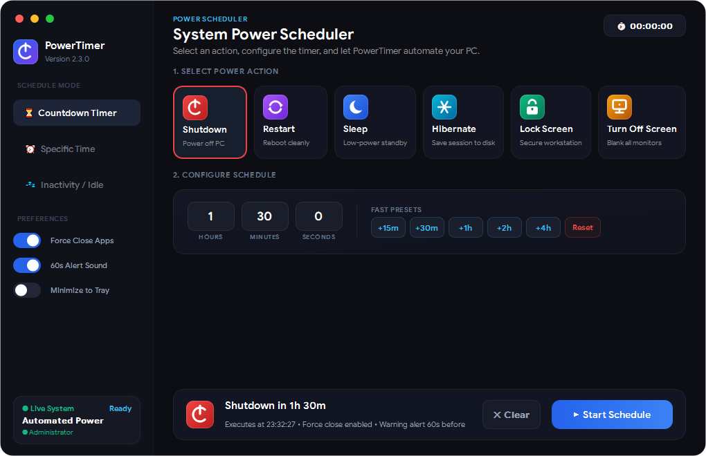
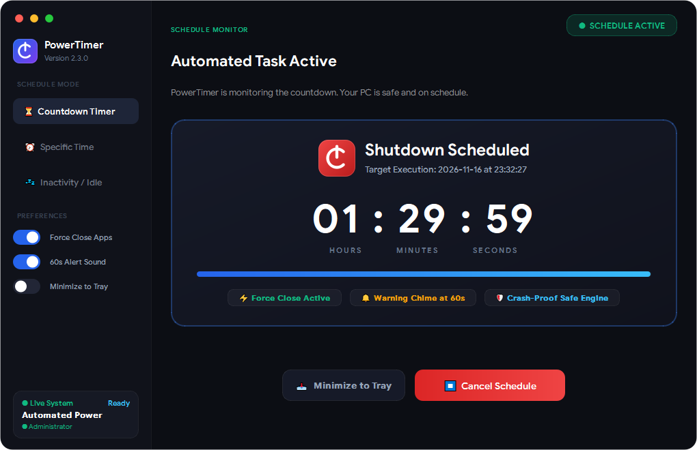

<div align="center">


# PowerTimer

**Modern, crash-proof system automation and power scheduler for Windows.**

[](https://github.com/a-salemi/PowerTimer)
[](https://www.python.org/)
[](https://riverbankcomputing.com/software/pyqt/)
[](https://github.com/a-salemi/PowerTimer/releases)
[](https://github.com/a-salemi/PowerTimer/releases/download/v1.0.0/PowerTimer.exe)
[](LICENSE)

<br />



</div>

---

## Overview

**PowerTimer** is a lightweight, open-source power automation utility designed for Windows 10 and 11. Built with PyQt6 and direct Windows API bindings, it offers an intuitive 3-step workflow, high-resolution custom vector icons, Google Sans typography, and a rock-solid crash-proof engine.

---

## ⚡ Features

### 1. Six Essential Power Actions
* **Shutdown:** Terminates running applications and safely turns off computer power.
* **Restart:** Reboots Windows cleanly without cutting system power.
* **Sleep:** Transitions system into an instant low-power standby state (RAM preserved).
* **Hibernate:** Writes active desktop session to disk and powers down.
* **Lock Screen:** Instantly locks the workstation requiring password to resume.
* **Turn Off Screen:** Blanks all connected displays until mouse or keyboard input is detected.

### 2. Three Flexible Scheduling Modes
| Mode | Description | Presets / Controls |
| :--- | :--- | :--- |
| **Countdown Timer** | Triggers chosen action after a relative time duration. | Quick pills: `+15m`, `+30m`, `+1h`, `+2h`, `+4h`, `Reset` |
| **Exact Time** | Executes action at an exact wall-clock time (e.g. `23:45:00`). | Auto-detects Today vs Tomorrow execution |
| **Inactivity / Idle** | Monitors hardware inputs and triggers when system is idle. | Slider configurable from 5 to 120 minutes |

### 3. Dedicated Running Dashboard
When a schedule begins, the interface switches into an active monitor dashboard:
* **Large Digital Clock:** High-contrast countdown display (`01:29:45`).
* **Progress Bar:** Real-time visual progress of remaining time.
* **One-Click Cancel:** Prominent red cancellation button to abort immediately.
* **System Tray:** Minimize to taskbar notification area and restore anytime.

### 4. Safety & Automation Preferences
* **Force Close Apps (`/f`):** Prevents hanging dialogs from blocking shutdown or reboot.
* **60s Warning Chime:** Audible system beep and warning notification 1 minute before execution.
* **Silent Background Operation:** Runs smoothly without console windows or excessive resource usage.

---

## 📥 Download

### Standalone Executable (No Installation Required)

Download the pre-compiled, self-contained binary for 64-bit Windows:

* 🚀 **[Download PowerTimer v1.0.0 (Windows x64)](https://github.com/a-salemi/PowerTimer/releases/download/v1.0.0/PowerTimer.exe)**
* 📦 **[View All Releases & Changelog](https://github.com/a-salemi/PowerTimer/releases)**

> **Note:** PowerTimer is portable — no setup installer, administrative prerequisites, or external dependencies required.

---

## 🖥️ Screenshots

<div align="center">

| Setup Wizard | Active Monitoring View |
| :---: | :---: |
|  |  |

</div>

---

## 🛠️ Run from Source

If you prefer running or modifying the source code directly:

### Prerequisites
* Windows 10 or Windows 11
* Python 3.10 or higher

### Installation
1. Clone the repository:
   ```bash
   git clone https://github.com/a-salemi/PowerTimer.git
   cd PowerTimer
   ```

2. Install dependencies:
   ```bash
   pip install -r requirements.txt
   ```

3. Launch the application:
   ```bash
   python app.py
   ```

---

## 📦 Building from Source

To compile a standalone, single-file executable using PyInstaller:

```bash
pyinstaller --noconfirm --clean --onefile --windowed --icon="icon.ico" --add-data "fonts;fonts" --name="PowerTimer" app.py
```

The output executable will be placed in the `dist/` directory.

---

## 👤 Author

* **Amir Salemi** ([@a-salemi](https://github.com/a-salemi))

---

## 📄 License

This project is licensed under the [MIT License](LICENSE) — see the LICENSE file for details.
